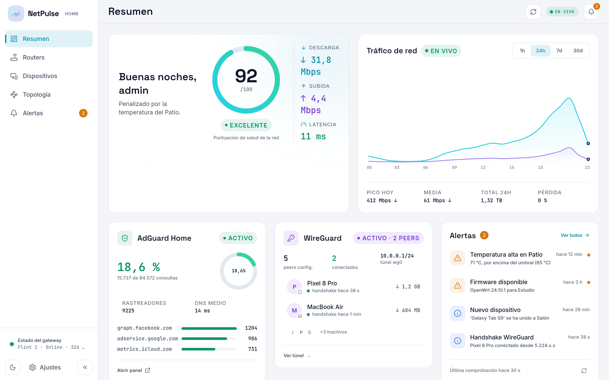
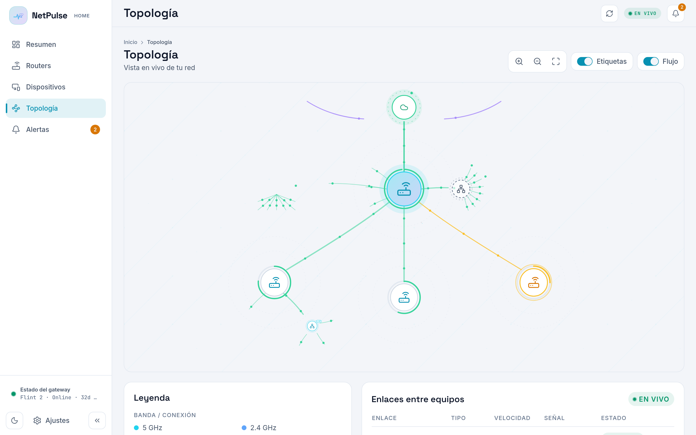
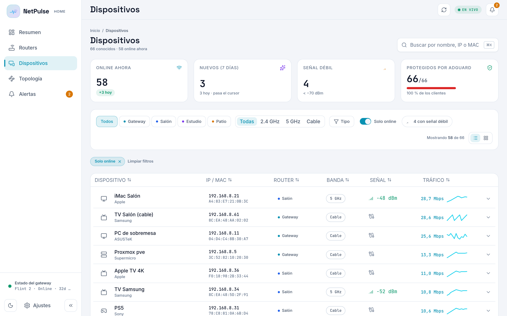
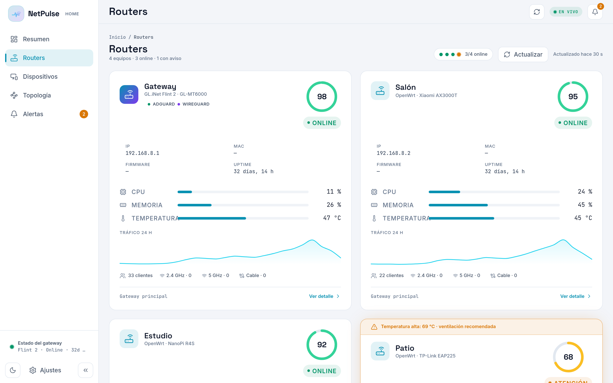

# NetPulse

<p align="center">
  <a href="README.md">English</a> |
  <a href="README.es.md">Español</a>
</p>

<p align="center">
  <a href="https://netpulse.cloudless.club"></a>
  <a href="https://demo.netpulse.cloudless.club"></a>
  <a href="https://github.com/gnacho/netpulse/releases"></a>
  <a href="https://github.com/gnacho/netpulse/actions/workflows/release.yml"></a>
  <a href="LICENSE"></a>
</p>

<p align="center">
  <strong>El pulso de tu red doméstica. En tiempo real. Sin nube.</strong><br>
  Vigila tus routers, dibuja la topología, puntúa la salud de la red y recibe
  alertas, desde un único binario autoalojado. Nada sale de tu LAN.
</p>

<p align="center">
  <a href="https://demo.netpulse.cloudless.club"><strong>Prueba la demo en vivo</strong></a> ·
  <a href="https://netpulse.cloudless.club/features"><strong>Tour completo de funciones</strong></a>
</p>

<p align="center">
  <picture>
    <source media="(prefers-color-scheme: dark)" srcset="assets/hero-es-dark.png">
    <source media="(prefers-color-scheme: light)" srcset="assets/hero-es-light.png">
    
  </picture>
</p>

## Míralo antes de instalar nada

No necesitas un solo router para ver NetPulse funcionando:

- **[demo.netpulse.cloudless.club](https://demo.netpulse.cloudless.club)** es la app
  real con una red de ejemplo completa cargada, en modo de solo lectura y sin
  registro. Navega, cambia el tema, cambia de idioma, mira las
  actualizaciones en vivo.
- **[netpulse.cloudless.club/features](https://netpulse.cloudless.club/features)**
  es el inventario completo: cada pantalla y cada función, con las decisiones
  técnicas y el alcance honesto de cada una.

## Qué te llevas

**Resumen de flota y una puntuación de salud que significa algo.** Un único
valor 0-100 condensa latencia, pérdidas, uptime y temperatura por router y
para toda la red, actualizado en vivo cada 5 segundos por SSE. Tráfico WAN
en vivo contra tu plan contratado, feed de alertas, estadísticas de AdGuard
Home y peers WireGuard en la misma pantalla (es la captura de arriba).

**Un mapa de topología que se dibuja solo.** Inferido en vivo del FDB del
bridge (y de LLDP donde está disponible, con LLDP-MIB en los switches
gestionados por SNMP): clientes cableados e inalámbricos
bajo el router y el puerto por los que hablan de verdad, switches
gestionados e inferidos, hosts de Proxmox con sus VMs anidadas y túneles
WireGuard trazados del peer a Internet. Los dispositivos callados conservan
su sitio; nada salta al refrescar. Arrastra los nodos a tu gusto y el layout
queda congelado para ti.

<p align="center">
  <picture>
    <source media="(prefers-color-scheme: dark)" srcset="assets/screenshot-topology-es-dark.png">
    <source media="(prefers-color-scheme: light)" srcset="assets/screenshot-topology-es-light.png">
    
  </picture>
</p>

**Cada dispositivo, clasificado.** Hostnames, IPs, detección de tipo
(patrones de hostname + OUI), primer visto, banda y señal para clientes Wi-Fi,
y el router al que está asociado cada uno. Etiqueta dispositivos, reserva IPs
y entérate cuando aparece algo nuevo.

<p align="center">
  <picture>
    <source media="(prefers-color-scheme: dark)" srcset="assets/screenshot-devices-es-dark.png">
    <source media="(prefers-color-scheme: light)" srcset="assets/screenshot-devices-es-light.png">
    
  </picture>
</p>

**Salud por router, de un vistazo.** Modelo, firmware, CPU, memoria,
temperatura, uptime y tráfico en vivo de cada router, con historial por
puerto y desglose de clientes por banda. Los switches gestionados sondeados
por SNMP también son ciudadanos de primera, y cualquier unidad se puede
pausar sin borrarla: sin sondeo ni alertas, con su histórico intacto.

<p align="center">
  <picture>
    <source media="(prefers-color-scheme: dark)" srcset="assets/screenshot-router-es-dark.png">
    <source media="(prefers-color-scheme: light)" srcset="assets/screenshot-router-es-light.png">
    
  </picture>
</p>

**Tests de velocidad WAN, a mano o programados.** Lanza una prueba desde el
servidor cuando la necesites o prográmala por intervalo, semanal, mensual o en
la hora de menos tráfico según los siete días anteriores. Los resultados se
guardan en SQLite, con una gráfica de una semana y el historial reciente.
Puedes elegir M-Lab NDT (la opción por defecto), Ookla, Cloudflare, LibreSpeed
o un endpoint HTTP personalizado, y recibir una alerta si la bajada queda por
debajo del porcentaje que hayas fijado para tu plan contratado.

**Sobre qué corre.** El servidor es un binario estático de Go en cualquier
caja Linux. El agente es quien habla con tus routers, y cómo llega depende
de la plataforma:

| Plataforma | Cómo corre el agente | Notas |
|---|---|---|
| OpenWrt (incl. GL.iNet) | Paquete nativo `netpulse-agent` (`.ipk`/`.apk`) | procd, config UCI, `luci-app-netpulse`, instalación y upgrade desde la app |
| MikroTik (RouterOS) | Pusher `routeros-pusher` externo en [netpulse-integrations](https://github.com/gnacho/netpulse-integrations/tree/main/routeros) | Solo lectura por la API binaria (fallback REST): sistema, puertos, DHCP, ARP, FDB, temperatura, firmware y tráfico WAN. La app lo despliega desde la sección Integraciones |
| Asuswrt / Asuswrt-Merlin | Pusher `asuswrt-pusher` externo en [netpulse-integrations](https://github.com/gnacho/netpulse-integrations/tree/main/asuswrt) | Binario estático bajo `/jffs/netpulse` (layout Merlin), con `/proc`, `iw` y `lldpd`. La app lo despliega por SSH desde Integraciones, con clave o contraseña |
| UniFi (controladora self-hosted) | Pusher `unifi-pusher` externo en [netpulse-integrations](https://github.com/gnacho/netpulse-integrations/tree/main/unifi) | Solo lectura, un sitio: gateways, switches y APs con bocas y uplinks, clientes con banda y señal, uptime del gateway. La app lo despliega desde Integraciones |
| Otras familias de router | Pusher Go separado en [netpulse-integrations](https://github.com/gnacho/netpulse-integrations) | Ver la [guía de integraciones externas](docs/external-integrations.md) |
| Switches gestionados | SNMP | Estado de bocas, velocidades y vecinos LLDP-MIB |
| Switches Realtek (RTL8372/8373) | Beacon embebido en el [fork de RTLPlayground](https://github.com/gnacho/RTLPlayground) | Estado de bocas, tasas en bytes y FDB por UDP. Instalación avanzada de firmware, ver la [guía del beacon para switches Realtek](docs/AGENTE-RTL-SWITCH.md) |

Las integraciones de fabricante viven fuera del servidor a propósito. Un router
OpenWrt no lleva código de RouterOS, Bbox ni de ninguna otra plataforma, y cada
integración se prueba y publica con su propio calendario. Quien tiene el hardware
lo valida, mientras NetPulse mantiene solo el contrato común de ingesta.

**Y el resto del tour:**

- **WireGuard**: peers con sus nombres reales, últimos handshakes,
  transferencia por peer.
- **AdGuard Home**: estadísticas de consultas, porcentaje bloqueado, dominios
  más bloqueados.
- **Wi-Fi y roaming**: matriz de señal por AP, estado 802.11r, utilización
  por canal, eventos de roaming persistentes.
- **Analizador de canales WiFi**: un espectro real por radio, cada red dibujada
  sobre el eje de frecuencias con puntuación de congestión por canal. Lee el
  aire y aconseja; nunca escribe en tus routers.
- **Actualizaciones de firmware de la flota**: actualiza dispositivos OpenWrt
  desde la UI, solo OpenWrt vanilla (lista filtrada, con nota explicativa).
- **Rack físico (preview en Labs)**: dibuja tu rack de 19", coloca tu hardware
  y deja que NetPulse proponga el cableado desde la topología detectada.
  Apagado por defecto.
- **Alertas que te encuentran**: temperatura, dispositivo nuevo, firmware
  disponible, WAN caída, problemas de agente; feed en la campana más canales
  de aviso (Web Push nativo, ntfy, Telegram y webhook saliente). Los canales
  de aviso solo llevan las alertas marcadas como urgentes; el nivel del feed
  (ninguna / urgentes / todas) se configura aparte en Alertas.
- **Multiusuario**: contraseñas bcrypt, roles admin y viewer, idioma por
  usuario (ES/EN).
- **PWA instalable**: móvil o escritorio, en vivo por SSE, temas claro/oscuro.
- **Ciudadano OpenWrt de primera**: paquetes nativos `netpulse-agent`
  (`.ipk`/`.apk`), página `luci-app-netpulse`, config UCI, init procd
  con self-heal. O el servidor entero en modo on-box.
- **Se actualiza solo**: el updater integrado comprueba releases y las aplica
  con swap atómico.
- **MQTT + Home Assistant (opcional)**: publica el estado de la flota (salud,
  clientes, vitales por router y alertas) en un broker MQTT; Home Assistant
  descubre las entidades solo. Los routers que se exponen solos con NetGrip no
  se duplican. Desactivado por defecto y sin nube: se configura desde la
  tarjeta MQTT de Ajustes (o con las variables de entorno `NETPULSE_MQTT_*`,
  o las opciones UCI `mqtt_*` en on-box). Topics, entidades y limitaciones en el
  [manual](docs/manual.es.md#home-assistant-mqtt).

**Un servidor MCP para tu asistente de IA.** NetPulse lleva un servidor
[MCP](https://modelcontextprotocol.io) embebido de solo lectura (streamable
HTTP en `/mcp`) para que tu asistente consulte el estado de la flota, la
salud por router, los dispositivos conocidos, los peers WireGuard, las
estadísticas de AdGuard Home, el grafo de topología y las alertas activas con
un token de API. Solo tokens (nunca la cookie de sesión), rate limit y cada
llamada registrada en el log de auditoría. Desactivado por defecto: actívalo
con `NETPULSE_MCP_ENABLED=1` y crea un token en Ajustes → Tokens de API.
Mantén el puerto en tu LAN: quien tenga el token puede leer el estado
completo de tu red.

Esto sigue siendo una selección: **[todas las funcionalidades están en la
web](https://netpulse.cloudless.club/features)**, una a una, y todo lo
anterior se puede tocar en la **[demo en vivo](https://demo.netpulse.cloudless.club)**.

## Empieza en unos cinco minutos

Necesitas una caja Linux con systemd (x86_64, arm64 o armv7; un LXC o VM
pequeña sobra) y routers OpenWrt/GL.iNet en tu LAN. MikroTik, Asuswrt/Merlin
y las controladoras UniFi se soportan mediante integraciones gestionadas desde
la app, y cualquier cosa con SSH o SNMP se añade a mano (mira la sección
plegada de más abajo).

**1. Instala el servidor** en la caja:

```bash
curl -fsSL --retry 3 -o /tmp/netpulse-install.sh https://raw.githubusercontent.com/gnacho/netpulse/main/install.sh && sh /tmp/netpulse-install.sh
```

El instalador es shell plano y legible ([inspecciónalo primero](install.sh)):
detecta distro y arquitectura, descarga la release verificada contra
`checksums.txt`, crea un servicio systemd `netpulse` enjaulado y muestra la
contraseña inicial de admin una sola vez. Re-ejecutar la misma línea
actualiza; `sh install.sh --uninstall` desinstala.

**2. Abre la app** en `http://<ip-del-servidor>:3000`, entra con la
contraseña impresa y el gateway ya está ahí: NetPulse lo encuentra en el
primer arranque por descubrimiento LAN (barrido TCP :22 con fingerprinting
ubus/GL-UI).

**3. Autoriza la clave SSH.** El servidor generó su propio par de claves en
el primer arranque. Copia la clave pública desde **Ajustes → Flota** y, en cada
router que quieras monitorizar, añádela:

```sh
echo "<clave pública de Ajustes>" >> /etc/dropbear/authorized_keys
```

**4. Instala los agentes desde la app.** Abre **Routers** y baja hasta la
tabla de agentes: cada router OpenWrt tiene su fila, y los que no tienen
agente ofrecen el botón **Instalar agente**. Un clic y el servidor registra
el agente, empuja el binario correcto para la arquitectura del router,
escribe la config y arranca el servicio; aparece como conectado en segundos.
Los routers a los que el servidor no llega por SSH usan el token de
emparejamiento (**Ajustes → Adopción de agentes**, mira la sección plegada
de abajo). Asuswrt/Merlin, MikroTik y las controladoras UniFi utilizan los
pushers de fabricante de la sección Integraciones.

**5. Llévatela contigo.** Instala la PWA desde el navegador (Añadir a
pantalla de inicio / Instalar app) y activa Web Push en Ajustes: las alertas
llegan al móvil aunque la pestaña esté cerrada.

¿Prefieres verla primero en tu propio hardware? `DEMO_MODE=1 AUTH_PASS=elige-una ./netpulse`
levanta la misma app con una red de muestra de 67 dispositivos, sin routers.
`AUTH_PASS` es obligatoria también en modo demo: protege la sesión web.

<details>
<summary><strong>Otras vías de instalación</strong></summary>

**Paquetes OpenWrt.** Cada release publica `netpulse-agent` y
`luci-app-netpulse` como paquetes instalables (`.ipk` para OpenWrt 24.10,
`.apk` para 25.12, más x86/64). Bájalos de la
[última release](https://github.com/gnacho/netpulse/releases):

```sh
# OpenWrt 24.10 (ipk)
opkg install ./netpulse-agent_*.ipk ./luci-app-netpulse_*.ipk

# OpenWrt 25.12 (apk)
apk add --allow-untrusted ./netpulse-agent-*.apk ./luci-app-netpulse-*.apk
```

El paquete trae una config vacía, así que apúntalo a tu servidor antes de
arrancar:

```sh
uci set netpulse-agent.main.server='http://<ip-del-servidor-netpulse>:3000'
uci set netpulse-agent.main.slug='<slug>'
uci set netpulse-agent.main.token='<token hex de 64>'
uci commit netpulse-agent
service netpulse-agent enable && service netpulse-agent start
```

Si el servidor ya puede hacer SSH al router, sáltate todo esto y pulsa
**Instalar agente** en la app: hace cada paso por ti.

**Token de emparejamiento.** Para routers a los que el servidor no llega por
SSH, Ajustes → Adopción de agentes muestra un token reutilizable:
`install-agent.sh --pairing-token` (ejecutado desde cualquier máquina que
alcance el router y el servidor) registra el agente en el primer contacto.

**Asuswrt / Merlin.** El soporte vive en la integración externa
[`asuswrt-pusher`](https://github.com/gnacho/netpulse-integrations/tree/main/asuswrt).
Compila su binario estático, crea el router con tipo `external` y copia el
binario y el fichero de entorno a `/jffs/`, que sobrevive a las
actualizaciones de firmware. El README de la integración explica el arranque
al boot y las actualizaciones manuales.

El pusher usa las sondas portables para sistema, WiFi, DHCP, FDB del bridge,
ARP y LLDP. Lo que necesita `ubus` o servicios de GL.iNet sigue ausente, y las
acciones de upgrade y reinstall del agente nativo no están disponibles.

Desde la sección Integraciones la app también puede instalar el pusher por
SSH. La llave del servidor autorizada sigue siendo lo preferente: cuando el
router solo acepta contraseña, como el dropbear de un Asuswrt de fábrica,
indica la contraseña en el formulario y el servidor conecta con ella. La
contraseña se guarda en un fichero compañero 0600 junto al de entorno de la
integración, nunca en la base de datos, y una contraseña equivocada se
reporta como `ssh_auth_failed` en vez de un fallo genérico de SSH.

**Sidecar de latencia.** Sondeos TCP de latencia por router a largo plazo,
opcionales:

```bash
curl -fsSL --retry 3 -o /tmp/netpulse-install-collector.sh https://raw.githubusercontent.com/gnacho/netpulse/main/install-collector.sh && sh /tmp/netpulse-install-collector.sh
```

**Modo on-box.** ¿Sin caja aparte? El servidor corre en el propio router
OpenWrt, con config UCI y TLS autofirmado con pinning SPKI.

</details>

## Actualizaciones e historial de versiones

Las releases van firmadas, con checksums, y llegan a tu flota por el
actualizador integrado; la app muestra un panel breve y legible de "qué ha
cambiado" antes de actualizar. El historial completo vive en
[CHANGELOG.md](CHANGELOG.md) y en la
[página de releases](https://github.com/gnacho/netpulse/releases); el plan
que viene, en [docs/ROADMAP.md](docs/ROADMAP.md).

## Documentación

- **[Manual de usuario](docs/manual.es.md)** (también en
  [inglés](docs/manual.en.md)): cada pantalla explicada, menú a menú, con
  procedimientos paso a paso.
- **[Web del proyecto](https://netpulse.cloudless.club)**: el proyecto en
  cinco minutos, con [tour de funciones](https://netpulse.cloudless.club/features),
  FAQ y capturas.
- **[Hoja de ruta](docs/ROADMAP.md)**: qué está hecho y qué viene.
- **[Discusiones](https://github.com/gnacho/netpulse/discussions)**:
  preguntas, ideas y hablar del futuro.

## Gracias enormes

NetPulse no existiría sin [OpenWrt](https://openwrt.org/). Toda la premisa
del proyecto, que el hardware de tu red sea realmente tuyo y no dependa del
firmware cerrado de un fabricante, solo es posible porque OpenWrt existe. Si
NetPulse te sirve, el mérito real es de la comunidad de OpenWrt.

Este proyecto también lo construye su comunidad: cada issue, cada pull request
y cada prueba con hardware real lo hace mejor. Gracias a todos los que habéis
aportado hasta hoy - las personas y el trabajo de cada release están nombrados
en el [CHANGELOG](CHANGELOG.md) y en las notas de cada versión.

Si quieres aportar código, lee antes [CONTRIBUTING.md](CONTRIBUTING.md): cada
PR pasa la compilación y la batería de tests completa, y el código nuevo del
servidor va en su propio fichero con su test.

## Historial de estrellas

[](https://www.star-history.com/#gnacho/netpulse&date)

## Licencia

[AGPL-3.0](LICENSE)
