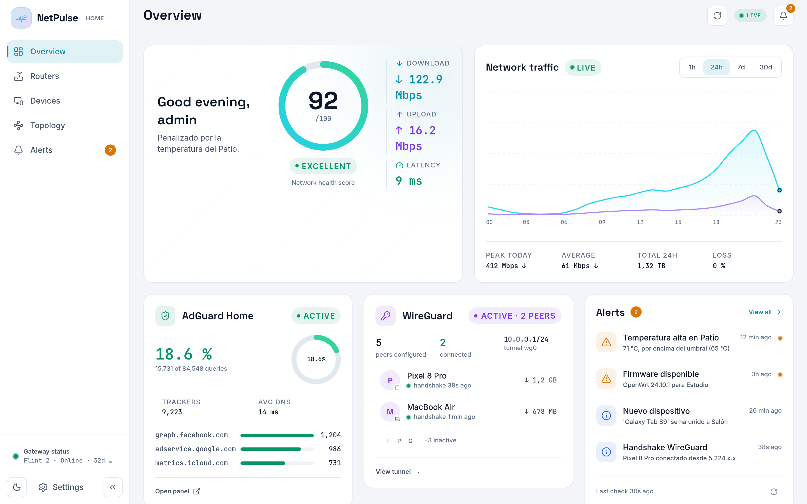
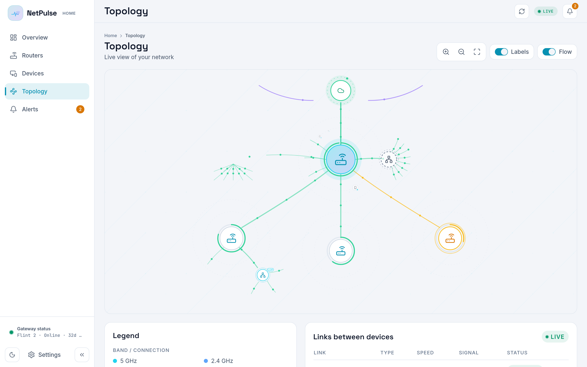
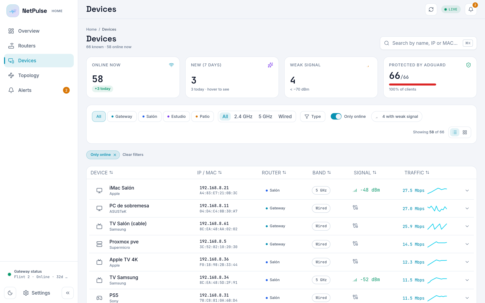
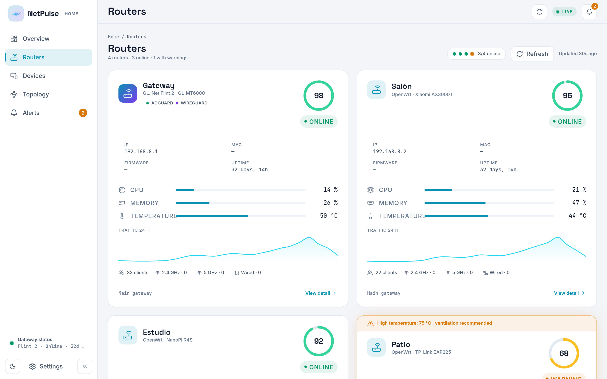

# NetPulse

<p align="center">
  <a href="README.md">English</a> |
  <a href="README.es.md">Español</a>
</p>

<p align="center">
  <a href="https://netpulse.cloudless.club"></a>
  <a href="https://demo.netpulse.cloudless.club"></a>
  <a href="https://github.com/gnacho/netpulse/releases"></a>
  <a href="https://github.com/gnacho/netpulse/actions/workflows/release.yml"></a>
  <a href="LICENSE"></a>
</p>

<p align="center">
  <strong>The pulse of your home network. Real time. No cloud.</strong><br>
  Watch your routers, draw your topology, score your network's health and get
  alerted, from a single self-hosted binary. Nothing ever leaves your LAN.
</p>

<p align="center">
  <a href="https://demo.netpulse.cloudless.club"><strong>Try the live demo</strong></a> ·
  <a href="https://netpulse.cloudless.club/features"><strong>Full feature tour</strong></a>
</p>

<p align="center">
  <picture>
    <source media="(prefers-color-scheme: dark)" srcset="assets/hero-en-dark.png">
    <source media="(prefers-color-scheme: light)" srcset="assets/hero-en-light.png">
    
  </picture>
</p>

## See it before you install it

You don't need a single router to see NetPulse working:

- **[demo.netpulse.cloudless.club](https://demo.netpulse.cloudless.club)** is the real app
  with a full sample network loaded, read-only, no sign-up. Click around, change
  the theme, switch languages, watch the live updates.
- **[netpulse.cloudless.club/features](https://netpulse.cloudless.club/features)**
  is the complete feature inventory: every screen and feature, with the
  technical decisions and the honest scope of each one.

## What you get

**Fleet overview and a health score that means something.** One 0-100 score
condenses latency, loss, uptime and temperature per router and for the whole
network, updated live every 5 seconds over SSE. Live WAN traffic against your
contracted plan, alert feed, AdGuard Home stats and WireGuard peers on the
same screen (that's the screenshot above).

**A topology map that draws itself.** Inferred live from the bridge FDB (and
LLDP where available, including LLDP-MIB on SNMP-managed switches): wired and
wireless clients under the router and port
they actually talk through, managed and inferred switches, Proxmox hosts with
their VMs nested, and WireGuard tunnels drawn from peer to Internet. Quiet
devices keep their place; nothing jumps around on refresh. Drag nodes to
arrange it and the layout stays yours.

<p align="center">
  <picture>
    <source media="(prefers-color-scheme: dark)" srcset="assets/screenshot-topology-en-dark.png">
    <source media="(prefers-color-scheme: light)" srcset="assets/screenshot-topology-en-light.png">
    
  </picture>
</p>

**Every device, classified.** Hostnames, IPs, type detection (hostname
patterns + OUI), first seen, band and signal for Wi-Fi clients, and the router
each one is attached to. Label devices, reserve IPs, and see when something
new shows up.

<p align="center">
  <picture>
    <source media="(prefers-color-scheme: dark)" srcset="assets/screenshot-devices-en-dark.png">
    <source media="(prefers-color-scheme: light)" srcset="assets/screenshot-devices-en-light.png">
    
  </picture>
</p>

**Per-router health at a glance.** Model, firmware, CPU, memory, temperature,
uptime and live traffic for each router, with port-level history and per-band
client splits. SNMP-polled managed switches are first-class citizens too, and
any unit can be paused without removing it: no polling, no alerts, history
kept.

<p align="center">
  <picture>
    <source media="(prefers-color-scheme: dark)" srcset="assets/screenshot-router-en-dark.png">
    <source media="(prefers-color-scheme: light)" srcset="assets/screenshot-router-en-light.png">
    
  </picture>
</p>

**WAN speed tests, on demand or on a schedule.** Run a test from the server
whenever you need one, or schedule it by interval, weekly, monthly, or during
the quietest hour based on the previous seven days of traffic. Results stay in
SQLite with a seven-day chart and recent history. Choose M-Lab NDT (the default),
Ookla, Cloudflare, LibreSpeed or a custom HTTP endpoint, and get an alert when
download speed falls below your chosen percentage of the contracted plan.

**What it runs on.** The server is one static Go binary on any Linux box.
The agent is what talks to your routers, and how it gets there depends on
the platform:

| Platform | How the agent runs | Notes |
|---|---|---|
| OpenWrt (incl. GL.iNet) | Native `netpulse-agent` package (`.ipk`/`.apk`) | procd, UCI config, `luci-app-netpulse`, in-app install and upgrade |
| Asuswrt / Asuswrt-Merlin | External `asuswrt-pusher` in [netpulse-integrations](https://github.com/gnacho/netpulse-integrations/tree/main/asuswrt) | Static binary in `/jffs`, using `/proc`, `iw` and `lldpd`. Manual install and update |
| RouterOS | Separate Go pusher in [netpulse-integrations](https://github.com/gnacho/netpulse-integrations) | System, ports, DHCP, ARP, FDB, temperature, firmware and WAN traffic |
| External router families | Separate Go pusher in [netpulse-integrations](https://github.com/gnacho/netpulse-integrations) | See the [external integrations guide](docs/external-integrations.md) |
| Managed switches | SNMP | Port states, speeds and LLDP-MIB neighbours |

Vendor integrations live outside the server on purpose. An OpenWrt router never
carries code for RouterOS, Bbox or another platform, and each integration can be
tested and released on its own schedule. Whoever owns the hardware validates it,
while NetPulse maintains only the shared ingest contract.

**And the rest of the tour:**

- **WireGuard**: peers with real names, latest handshakes, transfer per peer.
- **AdGuard Home**: query stats, blocked share, top blocked domains.
- **Wi-Fi and roaming**: signal matrix per AP, 802.11r status, channel
  utilization, persistent roaming events.
- **Wi-Fi channel analyzer**: a real spectrum per radio, every network drawn on
  the frequency axis with a congestion score for every channel. It reads the
  air and advises; it never writes to your routers.
- **Fleet firmware upgrades**: upgrade OpenWrt devices from the UI, vanilla
  OpenWrt only (device list filtered, with an explanatory note).
- **Physical rack (Labs preview)**: draw your 19" rack, place your hardware and
  let NetPulse propose the cabling from the detected topology. Off by default.
- **Alerts that find you**: temperature, new device, firmware available, WAN
  down, agent issues; bell feed plus notification channels (native Web Push,
  ntfy, Telegram and outgoing webhook). Notification channels only carry
  alerts marked as urgent; the feed level (none / urgent / all) is configured
  separately in Alerts.
- **Multi-user**: bcrypt passwords, admin and viewer roles, per-user language
  (ES/EN).
- **Installable PWA**: phone or desktop, live over SSE, light/dark themes.
- **A good OpenWrt citizen**: native `netpulse-agent` packages (`.ipk`/`.apk`),
  a `luci-app-netpulse` page, UCI config, procd init with self-heal. Or run the
  whole server on-box.
- **Self-updating**: the built-in updater checks for releases and applies them
  with an atomic swap.
- **MQTT + Home Assistant (opt-in)**: publish the fleet state (health, clients,
  per-router vitals and alerts) to an MQTT broker; Home Assistant discovers the
  entities on its own. Routers that expose themselves with NetGrip are not
  duplicated. Off by default and cloud-free: configured from the MQTT card in
  Settings (or with the `NETPULSE_MQTT_*` environment variables, or the
  equivalent `mqtt_*` UCI options on-box). Topics, entities and limits in the
  [manual](docs/manual.en.md#home-assistant-mqtt).

**An MCP server for your AI assistant.** NetPulse embeds a read-only
[MCP](https://modelcontextprotocol.io) server (streamable HTTP at `/mcp`) so
your assistant can query fleet status, per-router health, known devices,
WireGuard peers, AdGuard Home stats, the topology graph and active alerts
with an API token. Token-only auth (never the session cookie), rate limited,
every call logged for audit. Disabled by default: enable it with
`NETPULSE_MCP_ENABLED=1` and mint a token in Settings → API tokens. Keep the
port on your LAN: anyone with the token can read your whole network state.

That is still a selection: **[every feature is on the website](https://netpulse.cloudless.club/features)**,
one by one, and everything above is clickable in the **[live demo](https://demo.netpulse.cloudless.club)**.

## Get started in about five minutes

You need a Linux box with systemd (x86_64, arm64 or armv7; a small LXC or VM
is plenty) and OpenWrt/GL.iNet routers on your LAN. Asuswrt/Merlin is
supported through an external integration, and anything with SSH or SNMP can
be added by hand (see the folded section below).

**1. Install the server** on the box:

```bash
curl -fsSL --retry 3 -o /tmp/netpulse-install.sh https://raw.githubusercontent.com/gnacho/netpulse/main/install.sh && sh /tmp/netpulse-install.sh
```

The installer is plain, readable shell ([inspect it first](install.sh)): it
detects distro and arch, downloads the release verified against
`checksums.txt`, sets up a sandboxed `netpulse` systemd service and prints
the initial admin password once. Re-running the same line updates;
`sh install.sh --uninstall` removes.

**2. Open the app** at `http://<server-ip>:3000`, log in with the printed
password and the gateway is already there: NetPulse finds it on first boot
via LAN discovery (a TCP :22 sweep with ubus/GL-UI fingerprinting).

**3. Authorize the SSH key.** The server generated its own keypair on first
boot. Copy the public key from **Settings → Network** and, on each router you
want to monitor, append it:

```sh
echo "<public key from Settings>" >> /etc/dropbear/authorized_keys
```

**4. Install the agents from the app.** Open **Routers** and scroll to the
agents table: every OpenWrt router gets a row, and routers without an agent
offer an **Install agent** button. One click and the server registers the
agent, pushes the right binary for the router's architecture, writes the
config and starts the service; it shows up as connected within seconds.
Routers the server cannot SSH into use the pairing token instead
(**Settings → Agent adoption**, see the folded section below). Asuswrt/Merlin
uses the external pusher described there.

**5. Take it with you.** Install the PWA from your browser (Add to home
screen / Install app) and enable Web Push in Settings: alerts reach your
phone even with the tab closed.

Prefer to see it on your own hardware first? `DEMO_MODE=1 ./netpulse` runs
the same app with a 67-device sample network, no routers needed.

<details>
<summary><strong>Other install paths</strong></summary>

**OpenWrt packages.** Every release ships `netpulse-agent` and
`luci-app-netpulse` as installable packages (`.ipk` for OpenWrt 24.10,
`.apk` for 25.12, plus x86/64). Grab them from the
[latest release](https://github.com/gnacho/netpulse/releases):

```sh
# OpenWrt 24.10 (ipk)
opkg install ./netpulse-agent_*.ipk ./luci-app-netpulse_*.ipk

# OpenWrt 25.12 (apk)
apk add --allow-untrusted ./netpulse-agent-*.apk ./luci-app-netpulse-*.apk
```

The package ships an empty config, so point it at your server before
starting:

```sh
uci set netpulse-agent.main.server='http://<netpulse-server-ip>:3000'
uci set netpulse-agent.main.slug='<slug>'
uci set netpulse-agent.main.token='<64-hex token>'
uci commit netpulse-agent
service netpulse-agent enable && service netpulse-agent start
```

If the server can already SSH into the router, skip all of this and press
**Install agent** in the app: it does every step for you.

**Pairing token.** For routers the server cannot reach over SSH, Settings →
Agent adoption shows a reusable pairing token:
`install-agent.sh --pairing-token` (run from any machine that can reach both
the router and the server) registers the agent on first contact.

**Asuswrt / Merlin.** Support lives in the external
[`asuswrt-pusher`](https://github.com/gnacho/netpulse-integrations/tree/main/asuswrt)
integration. Build its static binary, create the router as type `external`
and copy the binary and environment file to `/jffs/`, which survives firmware
updates. The integration README covers boot startup and manual upgrades.

The pusher uses the portable probes for system data, wireless, DHCP, bridge
FDB, ARP and LLDP. Features that require `ubus` or GL.iNet services remain
absent, and the native agent upgrade and reinstall actions are not available.

**Latency sidecar.** Optional long-term TCP latency probes per router:

```bash
curl -fsSL --retry 3 -o /tmp/netpulse-install-collector.sh https://raw.githubusercontent.com/gnacho/netpulse/main/install-collector.sh && sh /tmp/netpulse-install-collector.sh
```

**On-box mode.** No spare box? The server itself runs on an OpenWrt router,
with UCI config and self-signed TLS with SPKI pinning.

</details>

## Updates and version history

Releases are signed, checksummed and pushed to your fleet by the built-in
auto-updater; the app shows a short human-readable "what changed" panel
before you update. The full version history lives in
[CHANGELOG.md](CHANGELOG.md) and on the
[releases page](https://github.com/gnacho/netpulse/releases); the plan ahead
is in [docs/ROADMAP.md](docs/ROADMAP.md).

## Documentation

- **[User manual](docs/manual.en.md)** (also in
  [Spanish](docs/manual.es.md)): every screen explained, menu by menu, with
  step-by-step procedures.
- **[Website](https://netpulse.cloudless.club)**: the project in five
  minutes, with a [feature tour](https://netpulse.cloudless.club/features),
  FAQ and screenshots.
- **[Roadmap](docs/ROADMAP.md)**: what's done, what's next.
- **[Discussions](https://github.com/gnacho/netpulse/discussions)**: questions,
  ideas and shape-the-future talk.

## Big thanks

NetPulse wouldn't exist without [OpenWrt](https://openwrt.org/). The whole
premise of the project, that you can own and control your network hardware
instead of depending on a vendor's closed firmware, only works because
OpenWrt exists. If NetPulse is useful to you, the real credit goes to the
OpenWrt community.

This project is also shaped by its community: every issue, pull request and
real-hardware test makes it better. Thanks to everyone who has contributed so
far - the people and the work behind each release are named in the
[CHANGELOG](CHANGELOG.md) and in every release's notes.

If you want to send code, read [CONTRIBUTING.md](CONTRIBUTING.md) first: every
PR runs the full build and test suite, and new server code lives in its own
file with its test.

## Star history

[](https://www.star-history.com/#gnacho/netpulse&date)

## License

[AGPL-3.0](LICENSE)
