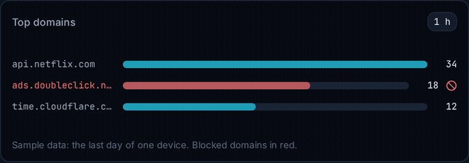
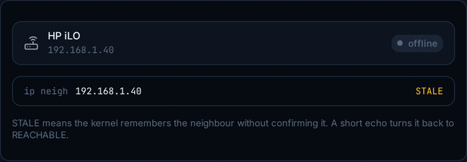

# NetPulse 2.54.0

This release is about what the screen was not telling you. Four features make the panel explain more, and a batch of fixes make it stop lying in the places where it was.

## Icons that name the device

Sixty smart-home icons in ten categories, searchable by their name in your language. A fridge stops looking like a generic box, and the search finds it by typing what it is. The catalog came from @Bann-DEV in #2107, and #2113 is the test that keeps it honest when someone adds a tile.

## What each device asks for

Per-device DNS activity from the AdGuard query log: the domains a client resolves, how often, and which ones were blocked, in a one hour or one day window. It sits in the device detail, next to the client that asked. #2081 built it, and #2119 made it show something, because it was reading with a lower case MAC while the log was stored in upper case.

## Quiet is not offline

A wired host with a static address that goes quiet used to drop off the map. Now the unit pings its stale neighbour and re-reads the table, so the address and the MAC are confirmed and an idle host stays online. #2108 added the recheck, #2109 extended it to IPv6 over NDP, and #2110 sweeps the subnets a unit routes to find hosts that never left an entry at all. The report behind it is #2063.

## Chinese and Russian

The whole interface in Chinese and in Russian, catalogs complete and reviewed. Dates and numbers follow each language too, not only the labels. Chinese came in #2070, from @Bann-DEV, and Russian in #2083, from @sers88.

## Also in this release

- **What's new page.** The app now explains each release with animated cards, in all four languages. #2116 added it, and the dot on the version stamp stays until you open it.
- **Traffic per client.** The device detail shows down, up and total over 1 hour, 24 hours, 30 days and 12 months, with the series for the same window. @tombacchetta asked for it in #2076 and the panel answers with the per-client history the server already had.
- **Wi-Fi clients with no IP** are marked as such, and leave one info entry in the activity log after two minutes instead of looking broken. #2111 closed the request @crowedavid opened in #1984.
- **Docker.** An optional server image with the UI and the agents inside, published to GHCR on every tag for amd64 and arm64. @sers88 wrote it in #2101 and the pipeline in #2105.
- **A smaller agent.** Built without `encoding/json/v2`: 7.8 MB down to 7.4 MB on amd64, which is 5.8% less. #2096 measured it before and after.
- **The client table** rebalances its columns and uses a single line in the 2xl tier, from #2106.
- **A quieter panel.** The SNMP community field says it is read-only (#2080), the unit column is translated (#2098), the splash background follows the theme (#2099) and the landing page counts demo clicks (#2093).

## Fixed

- The per-device DNS panel showed nothing until #2119 fixed the case mismatch between what ingest stored and what the request asked for.
- Responses from handlers that wait on a unit died at the 15 second write timeout, so a reinstall that worked still showed a red "server unreachable" line. #2112 gave each handler its own ceiling, and it came from the install report in #1894.
- The rack offers cables between fleet units again, from the FDB of the designated unit. The interface and the implementation had drifted apart, and #2120 put them back together.
- MACs are normalised with one parser at the boundaries in #2121, which was losing GL clients with hyphenated addresses and breaking the `?mac=` filters. #2134 closes the same hole on ingest, for any pusher that sends lower case or hyphenated addresses.
- Discovery no longer marks an authorised host as "Key missing" when its board has no `model` field, the case @xvlvx0 described in #2122.
- A chain of nested device hubs draws every level, each device once, and its cable is emitted once. #2123 and #2124 are the two halves of the same bug, reported by @spskeldon.
- A bridge unit only names the peer on a port when its FDB makes it unambiguous, which is what @crowedavid asked for in #1976 after a port insisted it was connected to the wrong switch.
- owut stops aborting because `-r` is repeated when the exclusion list is already in UCI, tracked in #2102.
- A polled switch is no longer drawn twice in the topology, from #2104.
- BATMAN-adv LOOP DETECT frames stop showing up as clients and stop holding topology nodes. @tam481 explained them in #1818 and @crowedavid confirmed they were mesh probes, not hosts.
- Data tables hidden for screen readers no longer stretch the page scroll area, from #2103.

## Thanks

- **@Bann-DEV** for the icon catalog in #2107 and the Chinese translation in #2070, and for #2113, the test that keeps the catalog honest.
- **@sers88** for the Docker image in #2101 and its pipeline in #2105, which turned a request into an install path, and for the Russian catalog in #2083.
- **@tam481** for the report in #1818 that explained a client list with more than a thousand phantoms, and **@crowedavid** for recognising what those frames were.
- **@crowedavid** again, for #1976, a port that named the wrong switch, and for the install report in #1894 that led to #2112.
- **@spskeldon** for #2123 and #2124, the two halves of the nested hub bug.
- **@tombacchetta** for #2076, asking for traffic per client and getting a panel that answers it.
- **@xvlvx0** for #2122, where an authorised host was labelled as missing its key.
- **@mgrupenhoff** for #2119, #2120 and #2121, three fixes at the MAC boundaries that were losing data quietly.
- **@fsolak47** for the presence reports in #2063 that put the stale neighbour recheck on the map.
- **@Korenchkin** for #2114, which caught the Docker instructions before anyone else did.

Every change, including the ones without a card, is in the [changelog](https://netpulse.cloudless.club/changelog).
