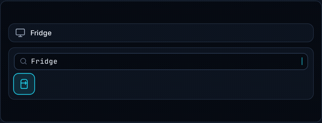
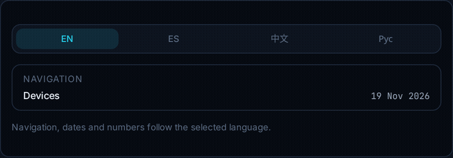

# NetPulse 2.54.0

This release is about what the screen was not telling you. Four features make the panel explain more, and a batch of fixes make it stop lying in the places where it was.

## Icons that name the device

Sixty smart-home icons in ten categories, searchable by their name in your language. A fridge stops looking like a generic box, and the search finds it by typing what it is. From @Bann-DEV (#2107).

## What each device asks for

Per-device DNS activity from the AdGuard query log: the domains a client resolves, how often, and which ones were blocked, in a one hour or one day window. It sits in the device detail, next to the client that asked (#2081).

## Quiet is not offline

A wired host with a static address that goes quiet used to drop off the map. Now the unit pings its stale neighbour and re-reads the table, so the address and the MAC are confirmed and an idle host stays online. The same check runs on IPv6 over NDP, and units that route sweep their subnets every few minutes to find hosts that never left an entry at all (#2108, #2109, #2110).

## Chinese and Russian

The whole interface in Chinese and in Russian, catalogs complete and reviewed. Dates and numbers follow each language too, not only the labels. Chinese is from @Bann-DEV (#2070, #2092).

## Also in this release

- **What's new page.** The app now explains each release with animated cards, in all four languages. The version stamp at the bottom of the sidebar shows a dot until you open it (#2116).
- **Traffic per client.** The device detail shows down, up and total over 1 hour, 24 hours, 30 days and 12 months, with the series for the same window (#2076).
- **Wi-Fi clients with no IP** are marked as such, and leave one info entry in the activity log after two minutes instead of looking broken (#2111).
- **Docker.** An optional server image with the UI and the agents inside, published to GHCR on every tag for amd64 and arm64. From @sers88 (#2101, #2105).
- **A smaller agent.** Built without `encoding/json/v2`: 7.8 MB down to 7.4 MB on amd64, 5.8% less (#2096).
- **The client table** rebalances its columns and uses a single line in the 2xl tier (#2106).

## Fixed

- The per-device DNS panel showed nothing: ingest stored MACs in upper case and the query went out in lower case (#2119).
- Responses from handlers that wait on a unit died at the 15 second write timeout, so a reinstall that worked still showed a red "server unreachable" line (#2112).
- The rack offers cables between fleet units again, from the FDB of the designated unit (#2120).
- MACs are normalised with one parser at the boundaries, which was losing GL clients with hyphenated addresses and breaking the `?mac=` filters (#2121).
- Discovery no longer marks an authorised host as "Key missing" when its board has no `model` field (#2122).
- A chain of nested device hubs draws every level, each device once, and its cable is emitted once (#2123, #2124).
- A bridge unit only names the peer on a port when its FDB makes it unambiguous (#1976).
- owut stops aborting because `-r` is repeated when the exclusion list is already in UCI (#2102).
- A polled switch is no longer drawn twice in the topology (#2104).
- BATMAN-adv LOOP DETECT frames stop showing up as clients and stop holding topology nodes (#1818, reported by @tam481 and @crowedavid).
- Data tables hidden for screen readers no longer stretch the page scroll area (#2103).

## Thanks

- **@Bann-DEV** for the icon catalog and the Chinese translation, and for the test that keeps the catalog honest (#2107, #2070, #2113).
- **@sers88** for the Docker image and its pipeline (#2101, #2105).
- **@tam481** for finding the BATMAN-adv frames behind a client list with more than a thousand phantoms (#1818).
- **@crowedavid**, **@fsolak47**, **@MassiPi**, **@Korenchkin** and **@spskeldon** for the reports behind most of the fixes in this release.
