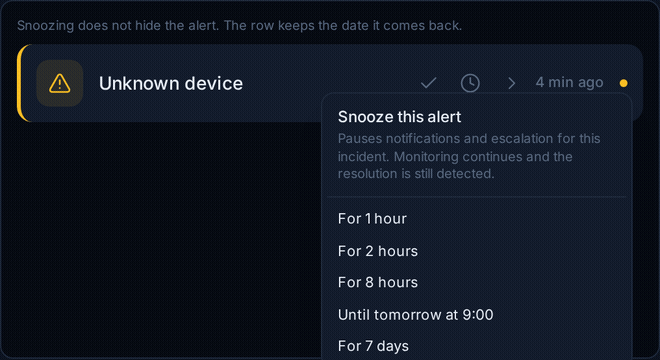
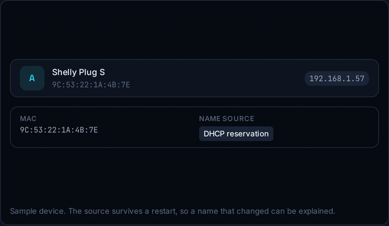

# NetPulse 2.55.0

Most of this release is about noise the panel was making. A unit polled over SSH was getting an HTTP request on its SSH port every cycle, a MediaTek router was writing twenty kernel errors per cycle because the agent asked a down interface for its transmit power, and the neighbours of an ISP segment were being listed as devices of your network. The alert log also gets the controls it should have had from the start.

## Read it, snooze it, or open it

Every alert row carries its three actions now instead of hiding them behind a click on the row: mark as read, snooze, and open the details. Snoozing does not hide it. It pauses notifications and escalation for that incident for one hour, two, eight, until tomorrow at 9:00 or seven days, and the row stays in the log with the time it comes back. Monitoring continues and the resolution is still detected. #2186 built it from the request in #2185.

## A name, and where it came from

The client detail says which source named the device: a DHCP lease, mDNS, reverse DNS, a reservation, a known MAC alias, the router firmware or the name you typed. The attribution is stored, so it survives retention and a restart, which is what makes a name that changed explainable. The rules did not change. A manual name always wins and a reservation beats an announcement. #2177 is the first phase of #2163. A global preference and a per-client choice need every candidate kept, not only the winner, and that is the next phase.

## Also in this release

- **AdGuard over HTTPS.** Remote AdGuard Home instances can be reached over TLS now, with an explicit opt-in for a self-signed certificate on a private one. HTTP and strict verification stay the default, and `ADGUARD_INSECURE_SKIP_VERIFY=1` does the same for environment setups. @tam481 reported the 400 in #2167.
- **Names from mDNS.** An mDNS hostname now feeds the device type rules (#2157) and replaces a generated DHCP placeholder without touching a reservation, an alias or a manual name (#2159). TXT metadata separates products that share a service, so an LG TV and a Marantz speaker over AirPlay stop looking the same (#2158).
- **The README lists the four languages.** It still said ES/EN, which @Bann-DEV noticed in #2156.
- **The language choice survives a strict CSP.** The early bootstrap moved out of the inline script that the production policy blocks (#2173).
- **Update history actions.** Expand, collapse and download are separate controls, and the download is no longer a button inside a button (#2168).

## Fixed

- A unit polled only over SSH was receiving an HTTP POST on port 22 before falling back to SSH, once per ubus call. dropbear logged three `Exit before auth` children per cycle and the pool had nothing to do with it. The ubus transport now uses the unit's web port and stops retrying after a transport failure (#2187, with the packet capture from @fsolak47 and the logs from @crowedavid in #1893).
- Neighbours learned on the gateway's WAN port were devices of the LAN. On a public subnet shared with the ISP that is dozens of foreign hosts in the client list and in the unknown-device alerts. Only the default-route peer is a WAN-side device now, the rest stay out of the inventory and out of the registry, and the rows older versions stored are gone (#2188, reported by @arypien).
- The agent ran `iwinfo` against interfaces that were down, and on MediaTek `mt_wifi` each call writes `RT_PRIV_IOCTL interface is down` at `KERN_ERR`. One router lost 95% of its log to this. Down interfaces are skipped before the call, and the classic iwinfo pass no longer runs again when the combined pass already answered (#2189, agent 3.0.49, reported by @danielz1z).
- The ports tile of an access point was fixed at 5/12 of the grid, so a five-jack chassis always showed a horizontal scrollbar. It sizes by port count now (#2190, reported by @fsolak47).
- Client traffic and overrides stopped matching for MACs with a hex letter after a restart, because the last tables still stored them lower case (#2170, by @mgrupenhoff).
- An agent push could publish an empty uplink list and erase the uplinks the server already knew (#2171, by @mgrupenhoff).
- A goroutine could write into the agent or overview data another one was reading, which corrupts a payload under load (#2164, by @mgrupenhoff).
- Wired clients behind a BATMAN backhaul port were attributed to the wrong mesh node (#2154, by @aloneangel45).
- `owut download` died during a remote ASU build instead of waiting for it, and the unit card showed nothing (#1978, reported by @crowedavid).

## Thanks

- **@mgrupenhoff** for #2170, #2171 and #2164, three defects he ran into on his own deployment, and for #2192, which leaves the rack hints with one dedup instead of two copies.
- **@arypien** for the WAN neighbour report in #2183, with the ARP table and the interface each entry came from. Without that the cause would still be a guess.
- **@danielz1z** for measuring the router log instead of guessing: 3,519 of 3,689 lines in 96 minutes, plus the ioctl behind them. #2176.
- **@fsolak47** for the packet capture that named the ubus transport in #1893, and for the ports tile in #2180.
- **@crowedavid** for three weeks of logs and captures in #1893, for #1978 and for the install report in #1894.
- **@tam481** for #2167, the AdGuard 400 that turned out to be plain HTTP against an HTTPS instance.
- **@aloneangel45** for #2154, the mesh node that was stealing its neighbours' clients.
- **@bugsileung** for #2153 and #2154, the loop probes counted as clients and the backhaul clients on the wrong node.
- **@Korenchkin** for #2114, which ended with the Docker image verified from the outside with an anonymous pull.
- **@Bann-DEV** for #2156, the README that still promised two languages.

Everything else is in the [changelog](https://netpulse.cloudless.club/en/changelog/).
